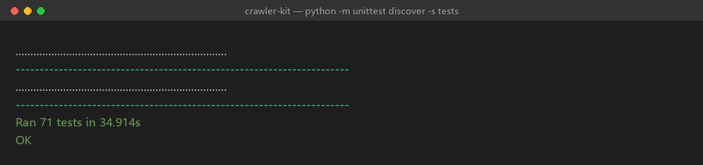

# crawler-kit

自用采集框架。零依赖核心，三个插件点，内建 TLS 指纹与并发。

**采集器的难点不是"能跑一次"，而是"能长期跑"。** 这个库只解决后者。



```bash
pip install -e .          # 或直接把 crawler_kit/ 复制进项目
python -m unittest discover -s tests
```

## 五条硬规则

每条都对应一次真实返工，不是设计洁癖。

| 规则 | 不做会怎样 |
|---|---|
| **限速必须全局** | "每个请求前 sleep" 在并发下叠乘成 N 倍速度，等于没限速 |
| **重试只由编排层决策** | 请求层自己重试会和框架重连叠加成连点，越重试越打不开 |
| **进度不能领先于数据** | 先推断点后落盘，续采时才暴露，且无法区分漏采与本来没数据 |
| **输出要是输入的纯函数** | 追加写会产生重复，跑十次得到十份数据 |
| **状态码是数据不是异常** | 4xx 抛异常就丢了"限流还是真拒绝"的信息，只能一概重试 |
| **有状态的东西必须每线程一份** | 共享连接池/会话让两个线程抢一个 socket，表现为随机连接重置或卡死 |

## 三个插件点

```python
class MySpider(Spider):
    name = "demo"
    page_size = 20

    def request(self, page):                    # 生成请求，不签名不发送
        return RequestSpec(url=f"https://example.com/api?page={page}")

    def parse(self, page, response):            # 解析响应，不落盘不去重
        return Outcome(records=response.json()["items"])
```

* `Spider` —— 怎么请求、怎么解析（**业务唯一要写的东西**）
* `Signer` —— 纯 Python 复算优先，`NodeBridgeSigner` 作兜底
* `Transport` —— 默认 urllib（零依赖）；需要 TLS 指纹时换内建的 `CurlCffiTransport`

`Spider` 上还有几个可选钩子，只在需要时才重写：

| 钩子 | 用途 |
|---|---|
| `pages(first, last)` | 页码不是等差数列时（游标、时间窗、id 列表） |
| `last_page()` | 开跑前就知道边界，后续页不会被请求一次再发现"到底了" |
| `stop_at(page, outcome)` | 只有跑到某一页才知道到底了 |
| `classify(page, response)` | 状态码不等于业务判决时；也可以在这里**抛异常整轮中止** |
| `signature()` | 参与断点校验的身份字段（只放改变页码含义的东西） |

其余（限速、退避、断点、去重、CSV、报告）全部内建，因为它们在每个项目里的
正确做法都一样，重写一遍只会重写一遍 bug。

## 跑一次

```python
from crawler_kit import Crawler, Config, Spider, RequestSpec, Outcome

Crawler(MySpider(), Config(work_dir="data")).run(first=1, last=10)
```

工作目录里会得到：

```
data/records.jsonl    事实日志（只追加，去重键从这里重建）
data/records.csv      整体重写，utf-8-sig（Excel 双击不乱码）
data/progress.json    断点
data/report.json      本轮汇总 + 失败页明细
```

**中断后直接重跑同一条命令**就是续采。跳过已完成页，不重复写数据。

## 分页

默认 `?page=N` 闭区间。规则不同就重写 `pages()`：

```python
def pages(self, first, last):
    return [self.cursor_at(first)]        # 游标/时间窗随便，只要有序
```

顺序翻页不是偷懒：并发翻页会让"哪些页完成了"变成不确定集合，断点就没法只
前进到连续完成的位置 —— 你要么丢页，要么重采。瓶颈从来不在本地循环。

## 断点

```python
Checkpoint(path, identity={"page_size": 20}, info={"last": 6})
```

* `identity` 只放**改变页码含义**的东西。换了它断点作废。
* `info` 只记录，不校验。页范围放这里 —— 否则"先跑 1~3、再扩到 1~6"这种
  正常续采会被误判成换任务，从头重来。

游标只推进到**连续完成**的位置。第 3 页失败、第 4 页成功时游标停在 2，
失败的页进补采队列。这是刻意的：游标越洞会让第 3 页在续采时永久丢失。

补采**只重跑可重试的页**。`Verdict.FATAL`（403 明确拒绝、接口改版、风控）的页
不参加补采 —— 再打一次是纯损失，对风控站点甚至会把处罚升级。它们仍会出现在
`report.json` 的 `failed_pages` 里，`PageStat.fatal` 标着原因。

中止是**正常退出路径**。插件在 `classify` 里抛异常（淘宝风控就是这么做的）会
穿透 `run()` 一路冒到调用方，但 `report.json` 和 CSV 仍会在 `finally` 里写出来 ——
否则"这一轮到底采了多少"就没法回答了。顺序与并发两条路径记账方式一致。

## 限流

```python
Config(min_interval=2.0)                  # 保守：固定间隔
Config(capacity=2, refill_per_sec=1/6)    # 令牌桶：允许开头两次突发
```

实测"10 秒内最多 2 次"→ 稳态上限 0.2 次/秒，留余量取 `1/6`。

并发下还有第二层：`RateLimitGate`。限速器管的是**主动节奏**（我打算多久发一次），
管不了**被动惩罚**（服务端刚说"6 秒后再来"）。一个 worker 拿到 429 时其余 worker
还在按原节奏敲门，退避窗口被反复重置，变成"越退避越打不开"。闸门把"现在起 N 秒
内谁都别发"变成全局事实。

## 并发

```python
Config(concurrency=4)     # 默认 1
```

并发只并行**网络等待**；写记录、累加统计、推进断点全部在一把锁里串行。
这不是保守，是必需的：拆成多把锁就会出现"记录已落盘但统计没算"、
"断点已推进但记录没写"这类中间状态，另一个 worker 正好能观察到。

默认 1 是刻意的 —— 并发会把"哪些页完成了"变成乱序集合，断点只能停在洞前面，
一个慢页就会把整轮速度钉住。加速应该是你显式要求的结果，不是默认惊喜。

被限流的那个 worker 自己**不再过闸门**（它已按服务端提示退避过），
否则同一个等待会睡两遍。

## 签名

```python
# 纯 Python 复算（首选：不需要 node，不怕升级）
PurePythonSigner(lambda spec: {"params": {**spec.params, "sign": md5(...)}})

# Node 桥（兜底）
make_node_signer("sign.js", work_dir=".bridge")
```

Node 桥走**工作目录里的临时文件**而不是管道 —— Windows 沙箱/杀软会把管道句柄
判为越权（`PermissionError: [WinError 5]`），文件读写正常。这个做法在淘宝项目里
验证过。

协议固定：`node sign.js in.json out.json`，脚本读 `in.json`、写 `out.json`。

## 测试

`tests/mock_target.py` 是可编程的假服务端：限流、5xx、半页、最后一页、
字段缺失都能开关。框架的错误几乎都只在服务端异常时才暴露，真站点上复现不起，
所以把每种异常做成断言。

```bash
python -m unittest discover -s tests -v
```

65 个用例，约 32 秒 → 现在 71 个，约 36 秒。

| 文件 | 守什么 |
|---|---|
| `test_e2e.py` | 服务端异常下的行为（限流、5xx、断点不越洞、续采不重复） |
| `test_units.py` | 我们自己的账（断点、去重、退避、限速） |
| `test_plugins.py` | 三个插件点的契约（签名不发请求、状态码不抛异常） |
| `test_concurrency.py` | 并发下仍然只写一次、断点不越洞、限速仍是全局的；中止能传出去；FATAL 不进补采 |

并发用例里有两个反直觉的点，都写进了注释：

* 本地假站快到 0ms，串行和并发耗时几乎一样，所以假站必须能人为变慢
  （`MockTarget(delay=...)`），否则"并发真的省了等待"根本没被测到；
* 假 `sleep` 不推进时间，闸门的冷却截止点会永远停在"未来"，凭空多睡一次。
  所以 `FakeSleep` 同时充当虚拟时钟，`Crawler` 也接受注入的 `clock`。

## 示例

```bash
python examples/demo.py             # 最小可跑：假站 + 续采
python examples/curl_transport.py   # 换传输层（TLS 指纹）+ 按页换指纹
python examples/fingerprint_curl.py # 指纹传输 + 并发对比（1 对 4）
python examples/signer_plugins.py   # 签名插件两种写法
```

`examples/fingerprint_curl.py` 让假站每页慢 0.3 秒，于是"并发 4 比串行快"
是可打印的事实（实测 1.24s 对 0.34s），而不是一句说法。

`examples/curl_transport.py` 展示按页换指纹：覆盖 `impersonate_for` 一个方法就够。
不要改成改 `self.impersonate` —— 传输对象被多线程共享，改属性就是让两个线程
互相踩。

## 结构

```
crawler_kit/
  crawler.py     编排：顺序翻页 / 断点推进 / 补采 / 报告
  limiter.py     令牌桶 / 固定间隔 / 冷却闸门（全局一个）
  retry.py       判决、退避、Retry-After 解析
  checkpoint.py  原子写断点
  store.py       JSONL 去重追加、CSV 整体重写
  transport.py   urllib / curl_cffi 指纹传输（状态码是数据，连接池每线程一份）
  signer.py      纯算 / Node 桥
  spider.py      业务插件基类
  log.py         UTF-8 控制台、{} 与 %s 双占位符、真实行号
tests/
  mock_target.py 可编程假站
  test_e2e.py    服务端异常下的行为
  test_units.py  我们自己的账算得对不对
  test_plugins.py 插件契约
  test_concurrency.py 并发下数据、断点、限速仍然正确
examples/
  demo.py            最小可跑
  curl_transport.py  换传输层（curl_cffi / TLS 指纹 / 按页换指纹）
  fingerprint_curl.py 指纹 + 并发对比
  signer_plugins.py  签名插件两种写法
```
